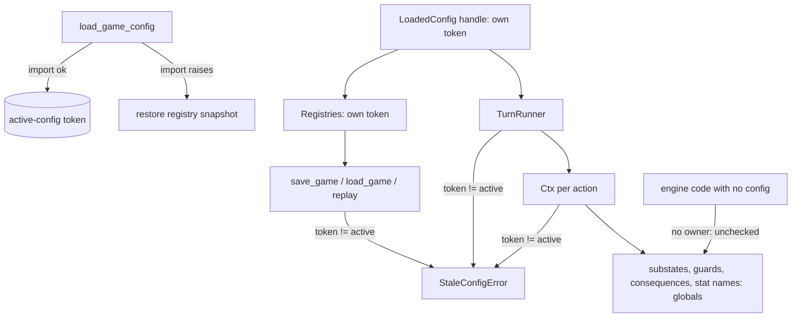

# Engine Contracts and Test Credibility - Plan

## Goal Capsule

- **Objective:** make the engine do what `docs/design/` says it does, or make the docs say what it does; make tests prove what their names claim; let CI run the port tests. Acts on the review reports #158 and #157 and absorbs the open issues #174, #175 and #177.
- **Product authority:** `docs/design/` governs architecture; `../research/` governs game behaviour, and this slice changes none. The reports' findings were re-verified at `731296a` (all eight #158 probes reproduce with the reports' numbers).
- **Execution profile:** `docs/AGENTS.md`: one orchestrator, one subagent per unit, serial in the order of the Unit Index. The orchestrator owns commits, the authoritative `make check` (through uv on 3.14 and 3.11) and the board: one GitHub issue per unit with `dep:` labels, created before U1. Work lands on `refactor/engine-contracts`, off `main`.
- **Stop conditions:** a seeded scenario, end-to-end run or recording changes its game outcome outside the three intended changes: dry scripted input raises, schema-2 saves are refused, and the intent arm's score is exact for long typed weights (stop and report); a red tree a unit cannot fix within its scope; a probe from #158 that no longer reproduces before its fix (re-check the finding before building).
- **Open blockers:** none.
- **Product Contract preservation:** changed: R1 narrowed to the checked entry points, because the handle's `handlers` and `effects` stay the global dicts until per-config registries (#178); R3 names registries beside handlers, as the owner check needs. Both are clarifications from planning-time feasibility review, inside the confirmed one-live-config decision.

---

## Product Contract

### Summary

One game config is live per process: loading a different config replaces it, and the old handle fails loudly. Content is frozen at the config package's import. A set of small engine fixes closes the reproduced contract gaps. The design docs are corrected to the checkpoint saves that exist. Tests are renamed or strengthened so each proves what it claims, and CI runs the research-dependent tests from a vendored source. No seeded game plays differently, except where the intent arm's score was inexact for a long typed weight.

### Problem Frame

Two Codex review reports (#157 on PR #148, #158 on the whole repository) found that loaded configs share mutable process-wide registries, that content is re-read from disk during play, and that several engine helpers and design-doc statements promise more than the code does. Three successive plans deferred them; no commit since the reviewed revision `c070a53` touched the affected engine files.

For today's single-config terminal play almost every finding is latent. They fail at the next step: a copied config (the documented way to make a new genre game) registers every name the original does, and loading it silently rewires the first config's effects (a replayed `+3` comes back as `300`). The future server (#178) inherits whatever ownership contract exists then.

The tests have a separate credibility gap. The coverage ledger stays 23/23 green with both Blueten-Eddie actions stubbed out. The shell tests' "every emitted key resolves" checks resolve hand-written examples, so a missing theme key passes all five tests in `tests/test_ble_shell.py`. CI checks out only this repository, so 274 research-dependent tests, all 260 `test_ports` among them, skip on every PR.

### Key Decisions

- **One live config per process, not isolated registries.** The product runs one game config at a time. Loading a different config replaces the active one; a handle to the replaced config raises a clear error when it saves, loads, replays or runs a turn, instead of running the new config's code. Reloading the same config stays allowed (the CLI does it in normal play). Per-config registries wait for #178.
- **Several themes of the same game may run at once.** Theme state already lives in per-session resolver instances; this slice pins that with a test rather than building anything.
- **Content is frozen at import.** Each config module loads and validates its YAML once, at package import. A load re-executes the package, so content is frozen for exactly one load. A structural test forbids content-file reads inside handler calls. The handler API does not grow; engine-owned content waits for a second game.
- **Correct the docs rather than build to them.** Saves are checkpoints: a state snapshot plus the RNG history at the turn menu or map prompt. Event-sourced replay, schema validation at every commit, and mid-handler resume are described as what they are, not built.
- **Save schema 3, older saves refused.** The codec and score changes alter what a save holds. A schema-2 save is refused by name and version, as mismatches already are; no migration code.
- **Vendor the research source into the public repo.** `mf-prg.bas` and `location-dialogue.yaml` are committed as test fixtures so CI runs the port tests. The user judged this redistribution acceptable. `../research/` stays authoritative, and a local check fails when the vendored copy drifts from it.
- **Input exhaustion is an error.** An input source that runs dry no longer completes an action with half its effects committed. Scripted callers get an exception; the terminal client's explicit cancel is unaffected.

### Requirements

**Config ownership and content lifetime**

- R1. Loading a config different from the active one makes it the active config; saving, loading or replaying through the previous handle, building a turn runner from it, or running an action owned by it raises an error that names both configs. Direct dictionary access through a stale handle's `handlers` or `effects` is not checked until per-config registries (#178).
- R2. Reloading the same config keeps working, and an effect or save built before the reload still equals and replays as one built after it.
- R3. The terminal passes its loaded config's handlers and registries to the turn runner instead of relying on the global default.
- R4. Content (entities, ranks, vehicles, weapons, `config.yaml`, encounters) is read once per load; editing a content file during a session does not change a loaded game.
- R5. A test fails when a handler reads a content file outside package import.
- R6. Two sessions of the same config with different themes run side by side in one process, each resolving its own theme's text.

**Engine contract fixes**

- R7. A save round-trips formula params losslessly, including numeric-string keys (`"01"` and `"1"` stay distinct).
- R8. A city map whose column count is not 40 is refused at load with a clear error; 40×25 stays the supported board.
- R9. An input source that runs dry raises out of `run()`, including mid-fight, and commits nothing from the unfinished action.
- R10. A substate that returns before its first yield hands its value to the parent.
- R11. `resume_pending_action` is removed from the public API; no save path depends on it.
- R12. A state that would fail schema validation on load is refused before a save is reported as written.
- R13. The action statuses nothing produces (`needs_input`, `started_combat`) are removed.
- R14. A location shell with more than 9 options is refused at load, because the one-key pick cannot reach the tenth.
- R15. The score under `c64_float_score`'s intent arm stays exact for long typed weights, so equal awards split differently rank the same.

**Documentation**

- R16. `docs/design/engine-architecture.md` and `CONCEPTS.md` describe checkpoint saves, the save-time schema check, menu/map-only save points, and the one-live-config contract in the present tense, with replay-from-event-log as future work.
- R17. The README states that the game is delivered as a repository checkout, not as a wheel.
- R18. The docs state that a cancelled action keeps its consumed RNG draws.

**Test credibility**

- R19. One shared check resolves every theme key that behavioural tests actually capture, replacing the shell tests' hand-written key dictionaries.
- R20. The coverage-ledger tests are named and documented as a citation and traceability audit; the ledger's player-facing rule applies per printed line, not per block.
- R21. The full-game end-to-end tests are named as late-game and jail scenarios.
- R22. The config-loader tests prove that a replaced handle fails loudly and that a same-config reload replays an earlier save; tests that pin global registry identity are rewritten.
- R23. #175's items are resolved: each misnamed test either proves its claim or is renamed, and each listed untested path gets a test or a recorded reason.
- R24. CI runs the research-dependent tests from the vendored fixtures with zero research skips.

**Refactors (#177)**

- R25. The score-weight helpers leave `setup.py` for their own module.
- R26. `engine/interactions.py` is split where its execution and its protocol definitions separate cleanly.
- R27. `play()`'s parameters are grouped so its signature stops growing per feature.
- R28. `WeaponInstance` fields only the game config reads (`price`, `ts`, `tg`, `ws`) move out of the engine types.
- R29. The stale local recording is replaced or removed, and `FIGHTLAB.md`'s recording command is checked.

### Acceptance Examples

- AE1. **Covers R1, R22.** Given config A is loaded and a copy B with a changed effect is then loaded, when a caller replays A's `+3` effect through A's handle, then it gets an error naming A and B, not `300`.
- AE2. **Covers R2.** Given Mafia is loaded, saved and reloaded in the same process, when the save is loaded with the new handle, then it replays identically.
- AE3. **Covers R4.** Given a running game, when `vehicles.yaml` is edited on disk, then the movement points stay 25 until the config is loaded again.
- AE4. **Covers R9.** Given a handler that applies `MoneyChange(100)`, then asks a `Confirm`, when the scripted input is empty, then `run()` raises and the cash is unchanged.
- AE5. **Covers R12.** Given a declared integer value set to a string, when the game is saved, then the save is refused and no file claims to be a valid save.
- AE6. **Covers R7.** Given formula params `{"labels": {"01": "first", "1": "second"}}`, when saved and loaded, then both keys and values survive as strings.
- AE7. **Covers R24.** Given a PR on GitHub, when CI runs, then `test_ports` runs all its 260 cases and the run reports no skip for a missing research tree.

### Success Criteria

- Every seeded scenario, end-to-end run and stored recording produces the same game outcome before and after the slice, except the intended changes: dry scripted input raises, schema-2 saves are refused, and the intent arm's score is exact for long typed weights (R15).
- Each of #158's eight probes, rewritten as a test, fails before its fix and passes after (break-the-feature proof, as `docs/AGENTS.md` asks).
- #157, #174, #175 and #177 can be closed against this slice's commits; #158 can be closed with its out-of-scope findings recorded.

### Scope Boundaries

- Per-config isolated registries and running several different configs at once (#178 revisits).
- A read-only state view projected through buffered effects (#157-5); handlers keep their local tracking.
- Mid-handler save and resume, event-sourced replay, an RNG-state checkpoint.
- General board geometry or topology; only the load-time refusal of other dimensions.
- Wheel packaging and installed-artifact play.
- A second transport, a second game config (#178), and the e2e demo (#176).
- The fidelity leftovers listed in `docs/plans/2026-10-12-002-next-slice-brainstorm-basis.md`.

### Dependencies / Assumptions

- `../research/` is a local git repository without a remote; the vendored fixtures are the only way CI gets the source.
- The tests read only `research/src/decompiled_basic/mf-prg.bas` and `research/research-data/pass-2/location-dialogue.yaml`.
- Combat recordings share the save schema constant and rebuild their snapshots on a mismatch, so the bump to 3 regenerates rather than invalidates them.
- Only one current test depends on silent input exhaustion (`tests/test_persistence.py::test_mid_slw_rent_save_resume_matches_uninterrupted`).

### Outstanding Questions

**Deferred to Implementation**

- Whether the null-only `pending_action` field leaves the save shape at the schema-3 bump (U4).
- Whether VICE captures for `c64_int_divide`'s negative quotients and `c64_val`'s edges can be taken inside U11, or stay recorded as model-only.

Planning resolved the rest: the save and recording schemas keep one constant (KTD-6), the #177 splits run last (U12, U13), the exact score has one source (KTD-9), and the drift check passes without the sibling tree (KTD-11).

### Sources / Research

- Reports: #158 (findings A1–A12, probe script and results), #157 (findings 1–7); open issues #174, #175, #177.
- Registry and reload: `engine/config_loader.py:210-228`, `:273-274`; `engine/effects.py:95-104`; `engine/locations.py:64-71`; `clients/terminal/session.py:842-849`; identity pins at `tests/test_config_loader.py:34` and 18 `handler is HANDLERS[...]` asserts in 9 shell test files and `tests/test_locations.py`.
- Content reads during play: per-call reads in 9 handler modules (turn, pub, aut, gang_war, police, ban, upkeep, sgl, waf: ranks, vehicles, gangsters, weapons), `handlers/new_game.py:96` (`config.yaml`); encounters already load at import in 10 modules; `city.yaml` is cached or read at import.
- Engine fixes: `engine/persistence.py:231-246` (codec), `:502` (pending resume); `engine/movement.py:67-90`, `:154`; `engine/interactions.py:866-875`, `:762`, `:1033`; `engine/actions.py:42-43`; `engine/effects.py:50` (`SCHEMA_VERSION = 2`).
- Doc claims to correct: `docs/design/engine-architecture.md:70`, `:148`, `:179-193`, `:130-134`; `docs/design/config-and-content-contract.md:164`; `CONCEPTS.md:11`.
- CI: `.github/workflows/check.yml:15`; research reads at `tests/helpers.py:62-86` and `tests/test_theme_strings.py:138-140`.

---

## Planning Contract

### Key Technical Decisions

- KTD-1. **A handle knows its owner by config path.** `load_game_config` records an active-config token, the resolved config path's digest (already derived for the module name in `engine/config_loader.py`), and sets it only after the package imports cleanly. Each `LoadedConfig` and the `Registries` it builds carry their own token. A path, not a counter, so a same-config reload revives every existing Mafia handle (R2) and the 49 module-level test handles keep working. A `dataclasses.replace` of a handle keeps its token.
- KTD-2. **The owner check sits where the handle enters the engine.** `save_game`, `load_game` and `replay` check `Registries`' token. `TurnRunner` gains a `registries=` argument (the handle's `Registries`, which carries the token) and checks it at construction; `step()` gains a keyword-only `owner=` that `TurnRunner` passes, stored on `Ctx` and checked when the action starts, so substate, guard-variable, consequence and stat-name lookups, which read globals, are covered by one check rather than by threading registries through them. Engine code run with no config (test-only substates) carries no owner and is not checked. A stale handle raises `StaleConfigError`, naming the handle's config and the active one.
- KTD-3. **A refused load leaves the active config intact.** The loader snapshots the registries before importing and restores them when the import or its validation raises. Today Mafia's `__init__.py` registers handlers and effects before it validates the weapon table, so a refused copy has already overwritten them.
- KTD-4. **Content becomes module constants at import.** Every handler-side read of ranks, vehicles, weapons, gangsters, the combat backdrop and `config.yaml` moves to a module-level constant built at import, as encounters already are. The path-taking `load_*` functions and `new_game(config_path=)` stay, because tests call them with copies; given the package's own default path, `new_game` and `_house_rules_map` use the import-time constants and read from disk only for an explicit other path. During play the session calls `new_game(record)`, so this path matters. The docstrings that justify per-call reads (`pub.py`, `waf.py`, `upkeep.py`) are reworded.
- KTD-5. **Key types are tagged in persistence, not in `json_safe`.** The save encodes non-string-keyed mappings with an explicit key-type tag inside `engine/persistence.py`; `json_safe` keeps its shape, because recordings, the driver and the purity harness rely on it. `_restore_numeric_keys`' guessing goes. `tests/helpers.py`' `_shape()` fingerprint moves with the codec.
- KTD-6. **One schema bump, to 3, after both save-shape changes.** The exact score (U3) and the codec (U4) land before the bump, so saves change shape once. A schema-2 save is refused by the existing `SchemaVersionError` path; recordings re-snapshot, as they do on any mismatch.
- KTD-7. **The save validates before it writes.** `save_game` checks the state against `Registries.state_schema` before the atomic replace, so an unloadable state never becomes a file. Commit-time validation is not added; the design doc says so instead.
- KTD-8. **Input exhaustion is a public error.** `run()` closes the step generator and raises `InputExhausted` when its input source runs dry; `_InputExhausted` and its completion branch in `step()` go. `step()` commits only in its completion branch, so closing it commits nothing. `_drive_fight` already propagates since #156.
- KTD-9. **The intent score has one exact source.** Under `c64_float_score`'s intent arm the score is an exact decimal held as a declared string value, the typed weight's text sits beside its float in `formula_params`, and `Player.gf` is derived from the exact value. Ranking at game end reads the exact value under intent. The C64 arm is untouched. `docs/solutions/` records the rule against two values that must agree.
- KTD-10. **Positional menus cap at 9 at load.** `engine/locations.py` refuses a location shell with more than 9 raw options when none carries a `key`; the one-key pick is the engine's contract with every client. Keyed menus (the turn menu) are exempt.
- KTD-11. **Research fixtures are vendored and resolved in one place.** `tests/fixtures/research/` mirrors the two research paths the tests read. One resolver in `tests/helpers.py` prefers the vendored copy, so CI and local runs read the same bytes. A drift test compares the vendored files with `../research/` when the sibling exists and passes without skipping when it does not.
- KTD-12. **The interactions split keeps its import surface.** The protocol definitions move to their own engine module and `engine.interactions` re-exports them, so no import site changes (86 test import lines). The driver stays in `engine/interactions.py`. Cited comments move with their code inside the citation roots.

### High-Level Technical Design

The owner check (KTD-1, KTD-2) and where each entry point meets it:

### Risks

| Risk | Mitigation |
|---|---|
| Five test sites load a foreign config and leave it active; later tests using module-level Mafia handles would raise. | An autouse `tests/conftest.py` fixture re-activates Mafia after any test that left another config active; tests that need a foreign config load it through a fixture that restores. |
| 19 identity asserts (18 `is HANDLERS[...]` plus `test_config_loader.py:34`) and a `setitem(HANDLERS, ...)` in `test_client_loop.py` pin global registries. | Rewrite them to assert through the handle (R22); keep `setitem` working by patching the active registry the handle reads. |
| The 274 research tests have never run in CI; a platform difference could surface on the first run. | U8 runs the suite through uv on 3.11 and 3.14 locally with `../research/` moved aside before pushing. |
| The per-line ledger rule exposes 14 uncited player-facing lines and 191 cited only through ranges; how many of the 191 sit in ranges wider than `NARROW` blocks is unmeasured. | U9 re-measures under its rule before dispatch, records the failing-line count in its issue, and cites every failing line. |
| Making a content read an import constant changes when YAML errors surface. | A malformed content file now fails at config load, which the existing refused-load tests already expect for weapons. |
| The interactions split invalidates line references in two solution docs (`engine/interactions.py:191/199/733-749`) that no test checks. | U12 updates them by hand and greps `docs/` for other `interactions.py:` line refs. |
| Renaming tests breaks `test_every_test_a_doc_names_exists`. | Each rename unit greps `docs/solutions/` for the old names and updates them in the same commit. |

---

## Implementation Units

### Unit Index

| U-ID | Title | Files touched | Depends on |
|---|---|---|---|
| U1 | Small engine fixes: substate, board, statuses, option cap | `engine/interactions.py`, `engine/movement.py`, `engine/actions.py`, `engine/locations.py` | none |
| U2 | Input exhaustion raises; pending resume removed | `engine/interactions.py`, `engine/persistence.py`, `tests/test_persistence.py` | U1 |
| U3 | Exact intent score from one source | `effects.py`, `setup.py`, `handlers/turn.py`, `handlers/game_end.py`, `content/state_schema.yaml` | U2 |
| U4 | Lossless save codec, save-time validation, schema 3 | `engine/persistence.py`, `engine/effects.py`, `tests/helpers.py` | U3 |
| U5 | One live config; stale handles raise | `engine/config_loader.py`, `engine/persistence.py`, `engine/turns.py`, `engine/interactions.py`, `clients/terminal/session.py`, `tests/conftest.py` | U4 |
| U6 | Content frozen at import | `handlers/*.py`, `setup.py`, `handlers/new_game.py` | U5 |
| U7 | Two themes side by side | `tests/test_theme_sessions.py` | U6 |
| U8 | Vendored research fixtures; port tests in CI | `tests/fixtures/research/`, `tests/helpers.py`, `tests/test_theme_strings.py` | U7 |
| U9 | Ledger as a traceability audit, per printed line | `tests/test_coverage_ledger.py`, `docs/coverage-ledger.yaml`, cited handlers and strings | U8 |
| U10 | Captured-key resolution; test names that match | `tests/helpers.py`, `tests/test_*_shell.py`, `tests/test_full_game_e2e.py` | U9 |
| U11 | #175: tests that prove their names | `tests/test_client_loop.py`, `tests/test_waf.py`, per-handler tests | U10 |
| U12 | Split `interactions.py` and the score-weight helpers | `engine/interactions.py`, new protocol module, `setup.py`, new score-weight module | U11 |
| U13 | `play()` options, `WeaponInstance`, the stale recording | `clients/terminal/session.py`, `clients/terminal/cli.py`, `engine/types/__init__.py`, `FIGHTLAB.md`, `docs/design/product-and-scope.md`, `docs/design/engine-architecture.md` | U12 |
| U14 | Docs say what the engine does | `docs/design/engine-architecture.md`, `docs/design/config-and-content-contract.md`, `CONCEPTS.md`, `README.md`, `docs/solutions/` | U13 |
| U15 | Close-out | `CLAUDE.md`, a new brainstorm basis | U14 |

Paths under `handlers/`, `content/`, `setup.py` and `effects.py` are relative to `data/game_configs/mafia_1920s/`.

### U1. Small engine fixes: substate, board, statuses, option cap

**Goal:** close the four contract gaps that touch no save or ownership code.

**Requirements:** R8, R10, R13, R14

**Dependencies:** none

**Files:** `engine/interactions.py` (`_run_substate`), `engine/movement.py` (`load_city`), `engine/actions.py` (statuses), `engine/locations.py` (`load_shells`), `tests/test_substate.py`, `tests/test_movement.py`, `tests/test_locations.py`, `tests/test_actions.py`.

**Approach:** Guard the child's first `next()` and return its `StopIteration` value. Refuse a city whose `dims.cols` is not 40 or whose grid does not match its dims; 40×25 stays the board. Remove `needs_input` and `started_combat`; keep `LocationActionRejected`. Refuse more than 9 positional options at shell load (KTD-10).

**Execution note:** each scenario is #158's probe turned into a test, seen red before its fix.

**Test scenarios:**
- A substate `yield from (); return 42` returns 42 to its parent; a substate that yields first still works.
- A 10-column city is refused at load with an error naming its column count; the Mafia city loads.
- A positional location shell with 10 options is refused at load; a keyed menu with 10 options loads; every Mafia shell loads.
- No code path references the removed statuses (a structural check over `engine/`).

**Verification:** the four probes fail on the parent commit and pass on this one.

### U2. Input exhaustion raises; pending resume removed

**Goal:** a dry input source can no longer half-complete an action, and the helper that rested on that behaviour goes.

**Requirements:** R9, R11; AE4

**Dependencies:** U1

**Files:** `engine/interactions.py` (`run`, `step`, `_InputExhausted`), `engine/persistence.py` (`resume_pending_action`, `__all__`), `tests/test_persistence.py`, `tests/test_driver.py`, `tests/test_recording.py`.

**Approach:** KTD-8. Delete `resume_pending_action` and its test `test_mid_slw_rent_save_resume_matches_uninterrupted`, the only test that relies on silent completion. Saves keep their `pending_action` field as null-only until U4's bump decides whether to drop it.

**Test scenarios:**
- Covers AE4. A handler applies `MoneyChange(100)`, asks a `Confirm`, and the input is empty: `run()` raises `InputExhausted` and the state's cash is unchanged.
- Exhaustion after the buffered effect but mid-fight raises and commits nothing (#174 item 1's case).
- Exhaustion inside a substate raises and commits nothing from the parent.
- A scripted run whose input suffices still completes as before.
- `engine.persistence` no longer exports `resume_pending_action`.

**Verification:** whole suite green with only the deleted test gone; the mid-fight scenario fails on the parent commit.

### U3. Exact intent score from one source

**Goal:** under `c64_float_score`'s intent arm, equal awards split differently rank the same, with no second value to keep in step.

**Requirements:** R15

**Dependencies:** U2

**Files:** `data/game_configs/mafia_1920s/effects.py` (`ScoreAndRank`, `WeaponBuyScore`), `setup.py` (`parse_score_weight`, `new_game`), `handlers/turn.py` (`truncated_score`), `handlers/game_end.py` (ranking), `content/state_schema.yaml`, `tests/test_score.py`, `tests/test_house_rules.py`, `docs/solutions/` (the two-sources learning).

**Approach:** KTD-9. Store the typed weight's text in `formula_params` beside its float; the intent arms and the truncation read and write the exact decimal; `gf` is derived. Gate the formula claims through `mafia-oracle` (`:1013`).

**Test scenarios:**
- A weight of `0.3333333333333333` and two awards split 1+2 versus 3 give equal exact scores and the same rank under intent.
- The C64 arm's results for the existing VICE-captured cases are unchanged.
- The game-end ranking under intent orders players by the exact score.
- `gf` equals the float of the exact score after every intent-arm write.

**Verification:** the split-award case fails on the parent commit; all score and house-rule tests stay green.

### U4. Lossless save codec, save-time validation, schema 3

**Goal:** a save round-trips what it holds, refuses an unloadable state, and marks the new shape.

**Requirements:** R7, R12; AE5, AE6

**Dependencies:** U3

**Files:** `engine/persistence.py` (`_state_to_dict`, `_config_from_dict`, `_combat_from_dict`, effect codec, `save_game`), `engine/effects.py` (`SCHEMA_VERSION`), `tests/helpers.py` (`_shape`), `tests/test_persistence.py`, `tests/test_recording.py`, `clients/terminal/session.py` (refusal text, if it names the version).

**Approach:** KTD-5, KTD-6, KTD-7. Decide here whether `pending_action` leaves the save shape (it is null-only after U2).

**Test scenarios:**
- Covers AE6. `{"labels": {"01": "first", "1": "second"}}` round-trips with both string keys.
- `fnm.overrides`' int keys and `dir_memory`'s keys round-trip as ints; mixed keys round-trip unchanged; a nested map of int keys inside string keys round-trips.
- Covers AE5. A declared integer set to a string makes `save_game` raise and leaves no file (and an existing save file untouched).
- A schema-2 save is refused with the version named; the terminal shows its existing refusal.
- A recording written at schema 2 re-snapshots and replays without divergence.

**Verification:** the opaque-map and schema probes fail on the parent commit; a fresh terminal game saves and loads.

### U5. One live config; stale handles raise

**Goal:** loading a different config makes the old handle fail loudly; the same config reloads freely.

**Requirements:** R1, R2, R3, R22; AE1, AE2

**Dependencies:** U4

**Files:** `engine/config_loader.py`, `engine/persistence.py` (`Registries`, entry checks), `engine/turns.py` (`TurnRunner`, `registries=`), `engine/interactions.py` (`step` `owner=`, `Ctx`), `clients/terminal/session.py` (pass `handlers=` and `registries=`), `tests/conftest.py`, `tests/test_config_loader.py`, `tests/test_effect_registry.py`, `tests/test_house_rules.py`, `tests/test_weapons_data.py`, `tests/test_client_loop.py`, the 9 `tests/test_*_shell.py` and `tests/test_locations.py` with identity asserts, `tests/test_waf_integration.py`, `tests/test_value_maps.py`.

**Approach:** KTD-1, KTD-2, KTD-3. Add the conftest fixture before flipping the check, so the suite stays green across the change. Rewrite identity asserts to check through the handle.

**Execution note:** land the conftest fixture and the A/B test first; see AE1 fail, then add the check.

**Test scenarios:**
- Covers AE1. Load A, load a copy B with a changed effect; replaying A's `+3` through A's registries raises `StaleConfigError` naming A and B.
- A's `TurnRunner` and a guard evaluation through A's handle raise after B loads.
- Covers AE2. Load Mafia, save, reload Mafia, load the save with the new handle: it replays identically; the old handle also works.
- A copy refused at load (bad weapon table) leaves Mafia's handlers and effects in place.
- A test-only substate run with no config still works.
- A `dataclasses.replace` of a handle keeps working.
- The terminal passes its handle's handlers and registries to the turn runner (a structural test over `session.py`).
- `step()` run with no owner stays unchecked; with a stale owner it raises before the handler's first yield.

**Verification:** whole suite green in file order and in reverse file order, run as `pytest $(ls tests/test_*.py | sort -r)` through the same uv invocation (to show the conftest fixture, not ordering, keeps it green).

### U6. Content frozen at import

**Goal:** a running game never reads content from disk again.

**Requirements:** R4, R5; AE3

**Dependencies:** U5

**Files:** `handlers/turn.py`, `pub.py`, `aut.py`, `gang_war.py`, `police.py`, `ban.py`, `upkeep.py`, `sgl.py`, `waf.py`, `new_game.py`, `setup.py` (`new_game`, `_build_state`, `_house_rules_map`, `pick_gangster`, `weapon_stats_by_id`, backdrop), `tests/test_content_lifetime.py`.

**Approach:** KTD-4. One module constant per content file, built at import; handlers read those.

**Test scenarios:**
- Covers AE3. With a loaded copy, editing its `vehicles.yaml` leaves the movement points at 25 until the copy is loaded again; after the reload they change.
- A spy on file reads, armed after `play()` starts, sees no content-file read across a scripted game with a fight, a purchase and a turn end (theme and drawing reads allowed).
- A malformed content file fails at config load.
- `new_game(config_path=copy)` still reads the copy's `config.yaml` (existing test stays green).

**Verification:** #158's content probe fails on the parent commit; the spy test fails when one constant is reverted to a per-call read.

### U7. Two themes side by side

**Goal:** pin that two sessions of the same config with different themes coexist.

**Requirements:** R6

**Dependencies:** U6

**Files:** `tests/test_theme_sessions.py`, `tests/fixtures/themes/test/`.

**Approach:** Interleave two sessions (classic and the test fixture theme) in one process and compare each one's resolved text with its own theme.

**Test scenarios:**
- Two interleaved sessions each resolve the location title from their own theme.
- Resolving in one session after the other has resolved leaves the first unchanged.

**Verification:** the test fails when one session's resolver is swapped for the other's.

### U8. Vendored research fixtures; port tests in CI

**Goal:** CI runs the research-dependent tests on every PR.

**Requirements:** R24; AE7

**Dependencies:** U7

**Files:** `tests/fixtures/research/src/decompiled_basic/mf-prg.bas`, `tests/fixtures/research/research-data/pass-2/location-dialogue.yaml`, `tests/helpers.py` (`MF_PRG`, `load_source`), `tests/test_theme_strings.py` (`_LOCATION_DIALOGUE`), `tests/test_coverage_ledger.py` and `tests/test_citations.py` (skip self-tests), `tests/test_research_fixtures.py`, `.github/workflows/check.yml` (if a skip-count guard is added).

**Approach:** KTD-11. Re-aim the two skip self-tests at an explicit absent path. Fix `load_source`'s definition-time default so a patched `MF_PRG` is honoured.

**Test scenarios:**
- Covers AE7. With `../research/` moved aside, the suite reports no skip for a missing research tree and runs all 260 `test_ports` cases.
- The drift test fails when the vendored file differs from `../research/`, passes when equal, and passes without skipping when `../research/` is absent.
- `load_source` given an absent explicit path still skips with its reason.

**Verification:** a local run without `../research/` shows the skip count drop from 275 to the fightlab skip alone; CI on the pushed branch shows the same.

### U9. Ledger as a traceability audit, per printed line

**Goal:** the ledger's tests say what they prove, and a hidden print in a cited block fails.

**Requirements:** R20 (and #174 item 3)

**Dependencies:** U8

**Files:** `tests/test_coverage_ledger.py`, `docs/coverage-ledger.yaml`, theme `strings/*.yaml` and handlers that need the 14 new citations, `docs/solutions/` (renamed test names).

**Approach:** Rename the tests and module docstring to a citation and traceability audit. Make `check_player_facing` iterate player-facing lines: a line passes when a shown citation's numbers include it or a shown range of at most `NARROW` (3) blocks covers it. Re-measure the failing lines under that rule before dispatch and record the count in the unit's issue. Cite the 14 uncited lines, re-reading each with `mafia-oracle` `conclude`.

**Test scenarios:**
- A block with one cited print and one uncited print fails the per-line rule (the `:12070` case before #173).
- A line covered by a narrow shown range passes.
- Every line the re-measure found failing (at least the 14 uncited ones) is now cited and the ledger passes.
- A line covered only by a range wider than `NARROW` blocks fails.

**Verification:** removing one new citation fails the ledger.

### U10. Captured-key resolution; test names that match

**Goal:** a theme key a handler emits but the theme lacks fails a test, and the end-to-end tests say what they run.

**Requirements:** R19, R21

**Dependencies:** U9

**Files:** `tests/helpers.py` (a captured-emission resolver), the 9 `tests/test_*_shell.py` files, `tests/test_full_game_e2e.py`, `docs/solutions/` (renamed test names).

**Approach:** One helper resolves every `(key, params)` a behavioural run captures through the theme. The shell tests drop their hand-written key dictionaries and resolve captured keys from their location's scenarios. Rename the end-to-end tests to late-game and jail scenarios.

**Test scenarios:**
- A ble handler emitting a key the theme lacks fails its shell test (#157's mutation).
- Every Mafia location's captured keys resolve.
- A key with missing params fails with the key named.

**Verification:** #157's missing-key mutation fails the shell tests, where it passed all five `tests/test_ble_shell.py` tests before.

### U11. #175: tests that prove their names

**Goal:** each #175 item either proves its claim or is renamed or recorded.

**Requirements:** R23

**Dependencies:** U10

**Files:** `tests/test_client_loop.py` (`TestWholeSessionDeterminism._script`), `tests/test_waf.py`, `tests/test_ban.py`, `tests/test_gang_war.py`, `tests/test_jobs.py`, `tests/test_win_flows.py`, `tests/test_cli.py`, `tests/test_persistence.py`, `tests/test_pub.py`.

**Approach:** Walk #175's list: fix the pub-walk script to reach the pub or rename it; give the train-camp test an outcome assertion; add the listed key-wait counts; pin the score-weight bound edge and `dir_memory`'s round trip; compare the pub's tips with the research corpus through the vendored fixture where it holds them. VICE captures for `c64_int_divide` negatives and `c64_val` edges are recorded as deferred if no VICE run is possible in the unit. The end-to-end `ScreenPlayer`'s blanket Acknowledge answer is recorded as a known limit in `tests/test_full_game_e2e.py`'s docstring (wait fidelity rests on the per-handler exit tests), and that reason is quoted when #175 is closed.

**Test scenarios:**
- The determinism script's walk lands in the pub and buys a barrel.
- The train camp's same-seed run asserts the training outcome.
- Each listed exit path asserts its key-wait count.
- A `--score-weight` within 1e-10 of a bound is refused or accepted as the CLI rule says.
- `dir_memory`'s round trip is pinned by U4's codec test, named in the #175 closure.

**Verification:** each new assertion fails with its feature broken.

### U12. Split `interactions.py` and the score-weight helpers

**Goal:** the two largest modules split along their real seams with no behaviour change.

**Requirements:** R25, R26

**Dependencies:** U11

**Files:** `engine/interactions.py`, a new engine protocol module, `data/game_configs/mafia_1920s/setup.py`, a new score-weight module beside it, `data/game_configs/mafia_1920s/__init__.py`, `handlers/new_game.py`, `docs/solutions/` (line refs to `interactions.py`).

**Approach:** KTD-12. Move the score-weight helpers with their citations; keep the package re-export `cli.py` uses.

**Test expectation:** none new; the whole suite, pyright and the citation and ledger checks are the proof. A tokenize comparison shows moved code unchanged.

**Verification:** whole suite green; `engine/interactions.py` keeps only the driver and re-exports the protocol definitions.

### U13. `play()` options, `WeaponInstance`, the stale recording

**Goal:** finish #177's remaining refactors.

**Requirements:** R27, R28, R29

**Dependencies:** U12

**Files:** `clients/terminal/session.py` (`play`, `TerminalSession`), `clients/terminal/cli.py`, `engine/types/__init__.py` (`WeaponInstance`, `validate_weapon`), `data/game_configs/mafia_1920s/combat_rules.py`, `setup.py`, `handlers/waf.py`, `clients/terminal/FIGHTLAB.md`, `docs/design/product-and-scope.md`, `docs/design/engine-architecture.md`, tests calling `play(`.

**Approach:** Group `play()`'s game options into one options value with the current keywords' defaults; update callers. Move `price`, `ts`, `tg` and `ws` to the config's weapon type, leaving the engine type with what the engine reads. Check `FIGHTLAB.md`'s recording command against the current code and note that recordings are local.

**Test scenarios:**
- `play()` with the options value behaves as the old keywords did (the existing client tests, converted).
- The engine's weapon type carries only `name` and `range`, and the config's weapon validation still refuses a bad weapon table.

**Verification:** whole suite green; `FIGHTLAB.md`'s command records a fresh fight that replays.

### U14. Docs say what the engine does

**Goal:** the design docs, concepts and README describe the engine as built.

**Requirements:** R16, R17, R18

**Dependencies:** U13

**Files:** `docs/design/engine-architecture.md` (`:70`, `:130-134`, `:148`, `:179-193`), `docs/design/config-and-content-contract.md` (`:164`), `CONCEPTS.md`, `README.md`, `docs/solutions/` (the action-spine replay wording).

**Approach:** Present tense for checkpoint saves, save-time schema check, menu/map save points, one live config, frozen content and RNG draws kept on cancel; replay from an event log as future work.

**Test expectation:** none; the citation checker holds any quoted fragments.

**Verification:** a grep for "event log", "suspended handler" and "validates the effect" finds only future-tense or corrected text.

### U15. Close-out

**Goal:** the plan state is unambiguous and the reports are closed.

**Requirements:** all; Success Criteria

**Dependencies:** U14

**Files:** `CLAUDE.md`, a new `docs/plans/<date>-NNN-next-slice-brainstorm-basis.md`.

**Approach:** Add this plan to CLAUDE.md's landed ledger. Drop a brainstorm basis carrying #176, #178, the fidelity leftovers of `2026-10-12-002`, every Scope Boundaries item and #177's unaddressed items (comment and docstring volume, `Rng.replayed` load cost) with the issue each came from, and anything the units found. Close #157 against this slice's commits, noting that #158 also covers its findings, close #158 with its out-of-scope findings named, and close #174, #175 and #177.

**Test expectation:** none.

**Verification:** `make check` green on 3.11 and 3.14; `gh issue list` shows none of #157, #158, #174, #175, #177 open.

---

## Verification Contract

| Gate | Check | When |
|---|---|---|
| Green tree | `uv run --python 3.14 --with-editable '.[dev]' --isolated make check`, and again with `--python 3.11` | Before every dispatch and every commit |
| Break-to-prove | Each new test fails with its feature broken (commit first, restore from a scratch copy, `PYTHONDONTWRITEBYTECODE=1`) | Every feature unit |
| Probe parity | #158's eight probes, as tests, fail on the parent of their fixing commit | U1-U6 |
| Outcome parity | Seeded scenarios, end-to-end runs and recordings keep their outcomes, except dry scripted input, schema-2 saves and the intent arm's exact score (R15) | Every unit |
| Order independence | The suite passes in reverse file order | U5 onward |
| No research | The suite runs with `../research/` moved aside, with no research skip | U8 onward |
| Fidelity | Changed citations re-read with `mafia-oracle` `conclude`; `tests/test_citations.py` green | U3, U9, U12 |
| Board | Every unit has its own issue before dispatch | Before each dispatch |

---

## Definition of Done

- U1-U15 each landed as a green commit on `refactor/engine-contracts`, and each unit's issue is closed.
- R1-R29 hold, and AE1-AE7 each have a named test.
- #157, #158, #174, #175 and #177 are closed against this slice's commits.
- No dead or experimental code from abandoned approaches remains.
- CLAUDE.md lists this plan as landed, and a brainstorm basis is the newest file in `docs/plans/`.
- A code review ran over the branch, its fixable findings are fixed, and a PR is open.
