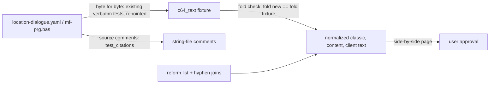

# String Normalization - Plan

## Goal Capsule

- **Objective:** every text the game shows reads as correctly spelled modern German: proper Groß-/Kleinschreibung, ä/ö/ü/ß, current Duden rules, and no C64 wrap padding — with the author's words and tone unchanged.
- **Product authority:** the user decides what correct German is, unit by unit, from an old → new side-by-side. `../research/` still decides *which words* each string has; this slice changes spelling and spacing only, never wording, game behavior or outcomes.
- **Execution profile:** `docs/AGENTS.md`: one orchestrator, one subagent per unit, serial in Unit Index order. The orchestrator owns commits, the authoritative `make check` (through uv on 3.14 and 3.11), the board (one GitHub issue per unit, created before U1) and the review gate: for every text unit it publishes the unit's side-by-side as a private page and commits only after the user approves it. Work lands on `refactor/string-normalization`, off `main`.
- **Stop conditions:** a behavioral test changes its outcome rather than a quoted string (stop and report); a string cannot be normalized without changing its words (record it for the user's decision instead of guessing); the user rejects a side-by-side (apply the corrections, re-publish, wait again).
- **Open blockers:** none.
- **Product Contract preservation:** changed: R11 — narrowed to docs that describe current behavior; research dossiers and landed plans keep quoting the C64 text (confirmed at plan time). R4, R6 and Key Decisions — user decisions during U3: in-text row breaks become spaces, and clear author typos are fixed on a named list. R4, R5, R8 — clarified at document review: an authored `\n` row stays, the rent-seizure rows join the kept layouts, location names are the title keys and gangster descriptions are covered (user-approved). Outstanding Questions resolved into Key Technical Decisions.

---

## Product Contract

### Summary

One pass over all player-facing and tool text: the classic theme's strings, content names, the title and art screens, fightlab and CLI text, and the docs and tests that quote them. Classic is rewritten in place to today's German spelling; the C64's 40-column wrap padding becomes a single space and the text flows to the terminal's width.

### Problem Frame

The classic theme is a verbatim port of what the C64 could print. The C64 had one letter case, no umlauts and no ß, so the source reads `als {rank} kannst du noch keine eigenen leute haben!` and `'ICH SUCHE EIN PAAR JUNGS FUER MEINE    GANG.'`. Two populations show it: the location screen texts from the game's disk files are ALL CAPS, and the BASIC `print` strings are all lowercase; both write umlauts as `ae`/`oe`/`ue` and ß as `ss`.

The disk-file texts are also padded with runs of spaces so each line wrapped at column 40 on the C64 (about 62 strings), sometimes splitting a word with a hyphen (`FALSCH-    GELD`). The terminal client does not wrap at 40, so on a wider terminal that padding shows as a gap in the middle of a sentence.

These were limits of the machine, not the author's spelling. A player today reads them as broken text.

### Key Decisions

- **Rewrite classic in place.** Classic becomes the normalized text; there is no second, verbatim theme. The verbatim C64 text survives in `../research/`, the vendored research copy, the per-line source comments in the string files, and a frozen fixture of today's text. Considered: a new default theme over a verbatim classic, or a new optional theme.
- **Umlauts and ß are restored.** The transliteration was the same machine limit as the case. A pair is restored only where German spells the umlaut (`fuer` → `für`, but `Feuer` and `neue` stay).
- **Today's spelling rules.** Current Duden: `dass`, `Tipp`, `wie viele`, `muss`. Considered: the 1986 rules (`daß`, `Tip`), or case and umlauts only.
- **The author's clear typos are fixed.** A slip that is plainly not the intended word (`Poliyei`, `erhälst`, a doubled word, a missing preposition) is corrected, each on a named author-typo list the fold check reads (user decision during U3).
- **Words and tone stay the author's.** Colloquial forms (`nich'`, `'ne`, `sowas`, `Zaster`), word choice, grammar and punctuation that is the author's style are kept. The pass is a spelling pass, not an edit.
- **Padding becomes one space; text flows.** The C64's line shape is not kept: no explicit line breaks are added and the client does not wrap at 40. A word the C64 hyphenated at its line break is joined (`Falschgeld`). A line break inside running text (a `\n` row of a multi-line print) also becomes a space, so the text flows; only a break that lays out a list, a table or columns stays (user decision during U3, superseding "an authored row stays"). Considered: the client word-wrapping at 40, or a `\n` wherever the C64 broke the line.
- **A fold check replaces "verbatim".** A normalized string must still be its source string once case is folded, ä/ö/ü/ß are written back as ae/oe/ue/ss, runs of spaces are collapsed, a joined wrap hyphen is split again, and each spelling-reform change on a named list is undone. That keeps the words tied to the source while the spelling changes.

### Requirements

**The text**

- R1. Every German string the game shows follows current German Groß-/Kleinschreibung, with nouns, sentence starts and the polite *Sie* forms capitalized.
- R2. ä, ö, ü and ß replace ae, oe, ue and ss wherever German spells them, and nowhere else.
- R3. Spelling follows the current Duden; each word changed for the 1996/2006 reform rather than for case or umlauts is on one named list with its source form.
- R4. A run of spaces that only padded a line to the C64's 40-column wrap becomes one space, and so does a `\n` row break inside running text; a break that lays out a list, a table or columns stays (R5).
- R5. Spacing that lays out columns or aligns output is kept: the year-end standings header, the safe's digit display, the rent seizure's rows and `{tab(39)}` sign, fightlab's aligned debug lines, the art boxes' borders, and any other column layout found during the pass.
- R6. No string changes its words, word order, tone, punctuation style or `{placeholders}` beyond R1–R4, the R3 list and the author-typo list.

**Coverage**

- R7. The pass covers all of the classic theme's string files.
- R8. The pass covers the names and texts the game shows from content data: weapons, vehicles, ranks, gangster names and descriptions, and fighter names. Location names are the theme's title keys (R7).
- R9. The pass covers the title screen and the location art text the terminal client draws.
- R10. The pass covers fightlab's strings and the CLI's help and error text, for spacing (their case is already normal English).
- R11. Tests and the docs that describe current behavior (design docs, `README.md`, `CONCEPTS.md`, `clients/terminal/FIGHTLAB.md`, `docs/solutions/`) quote the new text. Research dossiers and landed plans keep quoting the C64 source.

**Checks and review**

- R12. A test proves every normalized string folds back to its source string (the fold check in Key Decisions), so a wording change fails the suite.
- R13. The string files, the content files, the citation ledger, the design docs and the tests stop calling the classic text "verbatim" and say what it is: the source's words in today's spelling.
- R14. Before a unit's text lands, the user sees an old → new side-by-side of every string it changes and approves or corrects it.
- R15. No game behavior, outcome, RNG draw or key a player types changes; the existing behavioral tests still pass on their outcomes.

### Acceptance Examples

- AE1. **Covers R1, R2, R4, R12.** Given the pub's `'ICH SUCHE EIN PAAR JUNGS FUER MEINE    GANG. MAL SEHEN, WER DA IST...'`, the new text is `'Ich suche ein paar Jungs für meine Gang. Mal sehen, wer da ist...'`, and it folds back to the source.
- AE2. **Covers R2.** `faesser` becomes `Fässer`; `Feuer` and `neue` are unchanged, because German spells no umlaut there.
- AE3. **Covers R3, R12.** The pub's `TIP` becomes `Tipp`; the fold check passes only because `tip → Tipp` is on the reform list.
- AE4. **Covers R5.** The standings header `spieler:        kapital: punkte:` becomes `Spieler:        Kapital: Punkte:` with its column spacing intact.
- AE5. **Covers R6, R12.** Changing `'ne` to `eine` while normalizing fails the fold check.
- AE6. **Covers R4, R12.** The sgl menu's `'POLIZEI! IN IHRER KASSE IST FALSCH-    GELD VERSTECKT, DAS IST KONFISZIERT!'` becomes `'Polizei! In Ihrer Kasse ist Falschgeld versteckt, das ist konfisziert!'`, and it folds back to the source.

### Scope Boundaries

- Rewording, correcting the author's grammar, and translating any text.
- Keeping the C64's 40-column line shape on screen.
- Rewriting saves: a name already copied into a saved game keeps its old spelling when that save is loaded.
- Changing `../research/`, the vendored research copy, the research dossiers under `docs/dossiers/`, or landed plans.
- The per-line source comments beside each string: they quote the C64 source and stay verbatim.

### Dependencies / Assumptions

- Location titles and other ALL-CAPS headings become normal German too (`Pub/Bar (ein zwielichtiges Lokal)`); the reverse video that marks them stays.
- Content items are referenced by index, so renaming one changes display only (vehicles: `config.yaml` `start_vehicle: 0`; ranks: list index + 1 is the rank).
- Saved games carry fighter names in the state (`engine/state/__init__.py`); the old spelling showing on load is accepted.
- Every key read lowercases its input (`clients/terminal/__init__.py`, `clients/terminal/session.py`), so a prompt's shown key letter may change case.

### Sources / Research

- `data/game_configs/mafia_1920s/themes/classic/strings/` — 27 files, 494 keys; the padded disk-file texts are in the 12 location files.
- `tests/test_theme_strings.py` (`test_the_location_titles_are_the_research_titles`) and the `test_*_strings_verbatim` shell tests that compare the theme byte for byte with `research-data/pass-2/location-dialogue.yaml`.
- 52 test files quote theme text (361 fragment hits, most in the `test_*_shell.py` files and `tests/test_client_loop.py`); 28 docs do, most of them research dossiers.
- `tests/test_citations.py` — holds every backticked source quote to its cited line, ignoring case and whitespace; the string files' source comments stay under it.
- `docs/coverage-ledger.yaml` and `tests/test_coverage_ledger.py` — the per-line citation audit and its player-facing rule.
- `data/game_configs/mafia_1920s/entities/` — weapons, vehicles, ranks and gangsters, each headed "verbatim".
- `clients/terminal/ascii_art.py` — `title_screen` hard-codes "Druecke ENTER zum Starten."; `clients/terminal/cli.py` already reads its help text from the theme.

---

## Planning Contract

### Key Technical Decisions

- KTD-1. **Today's text is frozen as the C64-text fixture.** Before any string changes, the current classic strings, the entity names and descriptions, the encounter and scenario fighter names, and the client's display literals (title prompt, tagline, art captions) are copied to `tests/fixtures/c64_text/`, keyed as they are in the tree. The tests that pin classic byte for byte to `location-dialogue.yaml` (`test_*_strings_verbatim`, `test_the_location_titles_are_the_research_titles`) are repointed to the fixture, so research → fixture is still proven for the disk-file texts (the print strings stay tied to the source through their citation comments), and fixture → new text is the fold check's job. The `test_*_strings_verbatim` tests compare against inline literals today, so U1 adds the test that ties each fixture location key (`title`, `entry_prompt`, `menu.*`) to its `location-dialogue.yaml` field byte for byte; `tests/test_pub_tips.py`' research comparison is repointed at the fixture the same way.
- KTD-2. **The fold is one test helper.** A single function maps a string to its fold: lowercase, ä/ö/ü/ß → ae/oe/ue/ss, whitespace runs → one space, then each reform-list entry and each joined wrap hyphen mapped back to its source form. The fold check asserts fold(new) == fold(fixture) for every key, and that every key in the fixture still exists. Fold is many-to-one, so it catches changed words, not a wrong umlaut; the user's review catches those.
- KTD-3. **The reform list and the hyphen joins are data.** `tests/fixtures/c64_text/` carries one list of reform spellings (`tip → Tipp`, `wieviele → wie viele`) and one of hyphen joins (`falsch- geld → falschgeld`), each entry with the keys it applies to. An unused entry fails the check, as the citation allow-list does.
- KTD-4. **The side-by-side is generated, never hand-written.** A tool under `tools/` diffs the working tree's strings against the fixture and writes every changed key as old → new, grouped by file, flagging any string whose fold differs. The orchestrator publishes it as a private page per text unit and waits for approval (R14).
- KTD-5. **Tests take the new text by edit, not by loosening.** A test that quotes a theme string gets the new literal; no assertion is made case-insensitive to absorb the change. Edits to existing behavioral tests change only string literals and docstrings, which the orchestrator checks before committing (R15). Exempt: new tests a unit names in its Test scenarios, and the comparisons a unit lists by name under **Test logic changed** — research- or capture-pinned checks that move to the fixture or to a fold comparison.
- KTD-6. **Source comments and dossiers stay verbatim.** The per-line `# :NNNN \`print"…"\`` comments quote the C64 source and remain under `tests/test_citations.py`; research dossiers and landed plans are records of the source. Only the prose that calls a string "verbatim" changes (R13).
- KTD-7. **The title-screen prompt moves into the theme.** `title_screen`'s hard-coded "Druecke ENTER zum Starten." becomes a `client.*` key, normalized there, so the title prompt is no longer code text; `title_screen` takes the resolved prompt as a parameter. The tagline and the art captions stay literals in `clients/terminal/ascii_art.py`, normalized in place and fold-checked through the fixture.
- KTD-8. **Text is stored NFC.** Every normalized string is written in Unicode NFC, so an umlaut is one code point and column-width layouts (the status bar, the standings header) count it as one cell. A test asserts NFC over the theme and content files.
- KTD-9. **A fragment is cased by its place on screen.** A string the client joins after other text (a two-line print joined, a label followed by a value) is cased as the word that falls there, not as a sentence start. The side-by-side renders each template with its placeholders as visible markers (`⟨rank⟩`), and a short hand-kept list in the fixture names the key groups the client joins on screen, which the tool renders together so the user judges their casing in place.

### High-Level Technical Design

The proof chain once the fixture exists (KTD-1, KTD-2):

### Risks

| Risk | Mitigation |
|---|---|
| A wrong umlaut (`neue` → `nüe`, `Steuer` → `Stüer`) passes the fold check. | The fold is many-to-one by design; the side-by-side review is the gate for umlaut and case choices (KTD-2, KTD-4). |
| 52 test files quote theme text; a unit misses one and the suite goes red, or a fix loosens an assertion. | Each unit greps the tests for every fragment it changes; KTD-5 forbids loosening and the orchestrator checks the test diff is literal-only. |
| A behavioral test's expected text and its outcome sit in one assertion, so a careless edit changes the outcome check. | The orchestrator reviews each test hunk; outcome parity is a Verification Contract gate. |
| `tests/test_citations.py` scans docs and comments; editing a quoted fragment in a doc (not a source comment) can break a citation pairing. | Docs edits keep backticked source quotes verbatim (KTD-6); the citation test runs in every gate. |
| The captured-key shell tests resolve keys through the theme and compare to expected text; renamed client keys (KTD-7) break captures. | U6 adds the new key through the same captured-key path and updates its expected text. |
| `tests/fixtures/themes/test/strings/` deep-merges over classic, so a test on the test theme can still show classic text a unit changed. | Each text unit greps the tests for its fragments, test-theme tests included. |
| Gangster names appear in hired-gangster state and in recordings; a recording made before the change replays with old names. | Accepted (Scope Boundaries); recordings are local artifacts and re-record after schema changes anyway. |

---

## Implementation Units

### Unit Index

| U-ID | Title | Files touched | Depends on |
|---|---|---|---|
| U1 | C64-text fixture, fold check, side-by-side tool | `tests/fixtures/c64_text/`, `tests/text_fold.py`, `tests/test_text_fold.py`, `tools/text_side_by_side.py`, the `test_*_strings_verbatim` tests, `tests/test_theme_strings.py`, `tests/test_pub_tips.py` | none |
| U2 | Location screen texts | the 12 location string files' disk-file keys (`title`, `entry_prompt`, `menu.*`) | U1 |
| U3 | Location handler strings | the remaining keys of the 12 location string files | U2 |
| U4 | Game-flow strings | `turn`, `upkeep`, `setup`, `game_end`, `combat`, `police`, `gang_war`, `roadblock`, `win_flows`, `jobs`, `house_rules`, `session`, `_format` string files; `client` except `client.cli` | U3 |
| U5 | Content names | `entities/ranks.yaml`, `vehicles.yaml`, `weapons.yaml`, `gangsters.yaml`; fighter names in `content/encounters/`, `content/scenarios/` | U4 |
| U6 | Title prompt and art text | `clients/terminal/ascii_art.py`, `client.yaml` (`client.cli` and the new title-prompt key) | U5 |
| U7 | Docs and the "verbatim" wording | string-file and entity-file headers, `docs/coverage-ledger.yaml` prose, `docs/design/`, `README.md`, `CONCEPTS.md`, `clients/terminal/FIGHTLAB.md`, `docs/solutions/` | U6 |
| U8 | Close-out | `CLAUDE.md`, a new brainstorm basis | U7 |

String files are under `data/game_configs/mafia_1920s/themes/classic/strings/`; entity files under `data/game_configs/mafia_1920s/entities/`. Each text unit (U2–U6) also edits the tests that quote its strings.

### U1. C64-text fixture, fold check, side-by-side tool

**Goal:** the proof chain exists before any text changes, and the review page can be generated.

**Requirements:** R12, R14; AE1, AE3, AE5, AE6 (as fold-function cases)

**Dependencies:** none

**Files:** `tests/fixtures/c64_text/` (strings, entity names and descriptions, fighter names, client literals, reform list, hyphen joins, joined key groups), `tests/text_fold.py`, `tests/test_text_fold.py`, `tools/text_side_by_side.py`, `tests/test_*_shell.py` (`test_*_strings_verbatim`), `tests/test_theme_strings.py`, `tests/test_pub_tips.py`.

**Approach:** Copy today's text into the fixture (KTD-1). Write the fold function and the check (KTD-2, KTD-3); with nothing normalized yet the check passes trivially and the reform and hyphen lists start empty, so the unused-entry rule holds. Repoint the verbatim tests at the fixture, and add the fixture → `location-dialogue.yaml` test for the location keys (KTD-1). The tool writes old → new per key with placeholder markers, the joined key groups rendered together (KTD-9), and a fold-mismatch flag.

**Test logic changed:** the `test_*_strings_verbatim` tests, `test_the_location_titles_are_the_research_titles` and `test_the_tip_texts_are_the_research_corpus_word_for_word` move from the theme to the fixture.

**Execution note:** prove the fold check can fail before relying on it: a changed word in a scratch copy of one string must turn it red.

**Test scenarios:**
- Covers AE1. The fold of `'Ich suche ein paar Jungs für meine Gang. Mal sehen, wer da ist...'` equals the fold of the padded source.
- Covers AE6. With `falsch- geld → falschgeld` on the hyphen list, `Falschgeld` folds to the source's `FALSCH-    GELD`; without the entry it does not.
- Covers AE3. `Tipp` folds to `tip` only with the reform entry present.
- Covers AE5. `eine` in place of `'ne` fails the check, naming the key.
- A key removed from the theme but present in the fixture fails the check.
- A reform or hyphen entry that no string uses fails the check.
- The repointed verbatim tests still pass against the fixture.
- Every fixture location key (`title`, `entry_prompt`, `menu.*`) equals its `location-dialogue.yaml` field byte for byte; a changed fixture character fails, naming the key.
- The pub tip texts in the fixture equal the research corpus, as `test_pub_tips` asserted of the theme.
- Every string in the theme and content files is Unicode NFC (KTD-8).
- The tool, run on an unchanged tree, lists no changes; run on a scratch tree with one changed string, it lists exactly that key.

**Verification:** the fold check is seen red on a scratch change; the suite is green with no text changed.

### U2. Location screen texts

**Goal:** the disk-file texts read as normal German with no wrap padding.

**Requirements:** R1–R4, R6, R7, R11, R14; AE1, AE3, AE6

**Dependencies:** U1

**Files:** `title`, `entry_prompt` and `menu.*` keys of the 12 location string files; reform and hyphen entries in `tests/fixtures/c64_text/`; the `test_*_shell.py` files and other tests that quote these strings.

**Approach:** Normalize each key, joining wrap hyphens and collapsing padding; titles become normal German with their reverse video unchanged. Add each reform spelling and hyphen join to the lists. Update every test literal that quotes a changed string (KTD-5). Publish the side-by-side and wait for approval.

**Test scenarios:**
- The fold check passes for every location key.
- The pub, sgl and pol menus render with no run of two or more spaces inside a sentence.
- Each shell test that quoted a menu or entry string asserts the new text.

**Verification:** fold check green; side-by-side approved; edits to existing tests are literal and docstring changes only (KTD-5).

### U3. Location handler strings

**Goal:** the BASIC `print` strings of the 12 locations read as normal German.

**Requirements:** R1–R3, R5, R6, R7, R11, R14; AE2

**Dependencies:** U2

**Files:** the remaining keys of the 12 location string files (pub, ban, aut, bhf, ble, kdh, pol, sgl, slw, sph, sub, waf); the fixture's lists; the tests that quote them.

**Approach:** As U2, for the lowercase strings. Fragments joined on screen are cased by position (KTD-9). Keep `{placeholders}` and their adjacency exactly (`{stock}Fässer`), and keep the safe's digit spacing (R5).

**Test scenarios:**
- Covers AE2. `faesser` is `Fässer`; strings with `feuer`, `neue` or `steuer` keep `eu`.
- The fold check passes for every key of the 12 files.
- Every `{placeholder}` set per key is unchanged (an existing test already pins broken references; it stays green).

**Verification:** fold check green; side-by-side approved; behavioral location tests keep their outcomes.

### U4. Game-flow strings

**Goal:** the turn, setup, combat, police, ending and client strings read as normal German.

**Requirements:** R1–R3, R5, R6, R7, R11, R14; AE4

**Dependencies:** U3

**Files:** the `turn`, `upkeep`, `setup`, `game_end`, `combat`, `police`, `gang_war`, `roadblock`, `win_flows`, `jobs`, `house_rules`, `session` and `_format` string files, and `client.yaml` except `client.cli`; the tests that quote them, most in `tests/test_client_loop.py`; `tests/test_rent_countdown.py`.

**Approach:** As U3. The standings header keeps its column spacing. `upkeep.rent_late` keeps its rows and its `{tab(39)}` sign position; only the spelling inside each row changes (R5). Prompt key letters may change case (Dependencies / Assumptions). If the side-by-side runs long, the orchestrator may publish it in two pages.

**Test logic changed:** `tests/test_rent_countdown.py`'s VICE-capture comparison compares each row's fold with the capture row's fold, the minus still at column 39.

**Test scenarios:**
- Covers AE4. The standings header reads `Spieler:        Kapital: Punkte:` with its column offsets unchanged.
- A confirm prompt showing `(J/N)` still accepts `j`.
- The rent seizure renders in its C64 rows, each folding to the VICE capture's row, with the minus at column 39.
- The fold check passes for every key of these files.

**Verification:** fold check green; side-by-side approved; the end-to-end runs keep their outcomes.

### U5. Content names

**Goal:** the names the game shows from content data are normal German.

**Requirements:** R1, R2, R6, R8, R11, R14

**Dependencies:** U4

**Files:** `entities/ranks.yaml`, `entities/vehicles.yaml`, `entities/weapons.yaml`, `entities/gangsters.yaml` (names and descriptions), the `name` fields of `data/game_configs/mafia_1920s/content/encounters/*.yaml` and `content/scenarios/*.yaml`; the entity entries of `tests/fixtures/c64_text/`; tests that quote names (`tests/test_setup.py`, `tests/test_aut.py`, `tests/test_turn_menu.py`, `tests/test_config_loader.py`, `tests/test_weapons_data.py`, scenarios and fightlab tests).

**Approach:** Normalize each name (`fuesse` → `Füße`, `anfaenger` → `Anfänger`). Names in mid-sentence templates (`als {rank} kannst du …`) take noun capitalization, which is right for German nouns. Extend the fold check to the entity names, the gangster descriptions and the fighter names.

**Test logic changed:** `tests/test_weapons_data.py::test_weapon_index_is_the_order_121_reads_the_data` compares each weapon name's fold with its `mf-prg.bas:50100-50115` DATA record; prices and stats stay exact, and the DATA quotes stay verbatim.

**Test scenarios:**
- The fold check passes for every entity name.
- A new game's starting rank prints `Anfänger`; the starting vehicle prints `Füße`.
- The pub's recruit offer shows a normalized gangster name and description.
- The weapon table's names fold to the BASIC DATA names, in order, with their stats unchanged.
- The kdh ambush scenario's fight keeps its outcome with the new weapon names.

**Verification:** fold check green; side-by-side approved; seeded scenarios keep their outcomes.

### U6. Title prompt and art text

**Goal:** the text the terminal client draws has no C64 spelling, and fightlab and the CLI are confirmed free of padding.

**Requirements:** R1, R2, R5, R6, R9, R10, R11, R14

**Dependencies:** U5

**Files:** `clients/terminal/ascii_art.py`, `clients/terminal/session.py` (the `title_screen` call), `client.yaml` (`client.cli` and the new title-prompt key, KTD-7), `tests/test_terminal_renderers.py`, `tests/test_fightlab.py`, `tests/test_terminal_client.py`.

**Approach:** Move the title prompt into the theme and normalize it (`Drücke ENTER zum Starten.`). Normalize the tagline and the art captions in place; an art line whose word shrinks under umlaut restoration gets one space before its closing border, so the box keeps its column (R5). Fightlab's strings and the CLI help hold only alignment, no padding: confirm that with a check rather than edit them.

**Test scenarios:**
- The title screen prints the theme's prompt; the client source holds no display literal for it.
- Fightlab's `--debug` block keeps its `->` column aligned.
- The fold check covers the moved title prompt, the tagline and the art captions.
- Every art box line keeps its closing border at the column it had before.
- No fightlab or CLI string holds a padding run (alignment runs are listed in the check).

**Verification:** side-by-side approved; the fightlab and renderer tests green.

### U7. Docs and the "verbatim" wording

**Goal:** no file still claims the classic text is verbatim C64 text, and current-behavior docs quote the new text.

**Requirements:** R11, R13

**Dependencies:** U6

**Files:** the headers of the string files and entity files, `docs/coverage-ledger.yaml` prose, `docs/design/`, `README.md`, `CONCEPTS.md`, `clients/terminal/FIGHTLAB.md`, `docs/solutions/`, test docstrings that say "verbatim" or "byte for byte" about classic; a new `docs/solutions/` entry on the fold check.

**Approach:** Reword "verbatim" to "the source's words in today's spelling" where it describes classic, and keep it where it describes the fixture or a source comment. Update quoted strings in current-behavior docs; leave backticked source quotes, dossiers and landed plans alone (KTD-6). Record the fold check and the review gate as a learning.

**Test scenarios:**
- No string or entity file header calls its values verbatim (a grep-style test over those headers).
- `tests/test_citations.py` stays green after the doc edits.

**Verification:** `make check` green; a grep for "verbatim" over `themes/` and `entities/` finds only references to the fixture or the source comments.

### U8. Close-out

**Goal:** the plan state is unambiguous.

**Requirements:** all

**Dependencies:** U7

**Files:** `CLAUDE.md`, a new `docs/plans/<date>-NNN-next-slice-brainstorm-basis.md`.

**Approach:** Add this plan to CLAUDE.md's landed ledger. Write a brainstorm basis carrying the previous basis's open items (#176, #178, #204, #205 and its residuals) and anything this slice left.

**Test expectation:** none — docs only.

**Verification:** `make check` green on 3.11 and 3.14; every unit issue closed.

---

## Verification Contract

| Gate | Check | When |
|---|---|---|
| Green tree | `uv run --python 3.14 --with-editable '.[dev]' --isolated make check`, and again with `--python 3.11` | Before every dispatch and every commit |
| Fold check | `tests/test_text_fold.py` green: every key folds to its fixture text; no unused reform or hyphen entry; every string NFC | Every text unit |
| User review | The unit's side-by-side was published and the user approved it | Before every U2–U6 commit |
| Outcome parity | Behavioral tests keep their outcomes; edits to existing tests change only string literals and docstrings, except the comparisons a unit names under **Test logic changed** | Every unit |
| Citations | `tests/test_citations.py` green; source comments unchanged | Every unit |
| Break-to-prove | The fold check fails on a changed word in a scratch copy | U1 |
| Board | Every unit has its own issue before dispatch | Before each dispatch |

---

## Definition of Done

- U1–U8 each landed as a green commit on `refactor/string-normalization`, and each unit's issue is closed.
- R1–R15 hold, and AE1–AE6 each have a named test or fold-check case.
- Every U2–U6 side-by-side was approved by the user.
- CLAUDE.md lists this plan as landed, and a brainstorm basis is the newest file in `docs/plans/`.
- A code review ran over the branch, its fixable findings are fixed, and a PR is open whose body uses one `closes #N` per issue.
